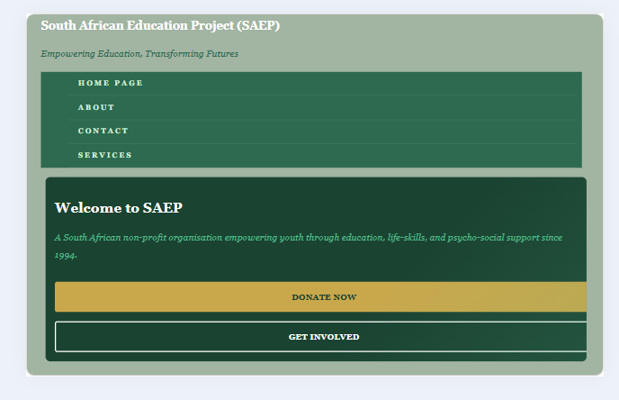
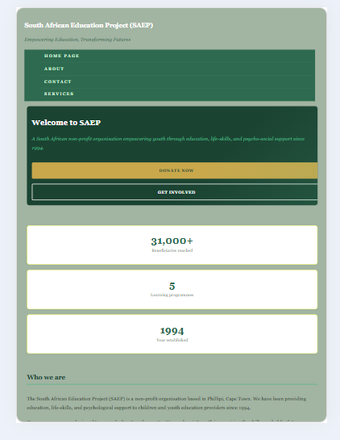

# South African Education Project
Empowering Education, Transforming Futures
the SAEP is a non-profit organization that offers children and the youth the education and life skills needed for future education or employment.
# Website pages
* [Homepage](index.html)
* [About](pages/about.html)
* [Contact](pages/contact.html)
* [Services](pages/services.html)
# Features
* Built with modern HTML senamatic elements.
*Structured Layout matching an original wireframe blueprint.
*Organized file architecture using subfolders.
*External CSS stylesheet for consistent styling across all pages.
*Responsive design that works on desktop, tablet, and mobile devices.
*interactive navigation with hover and focus effects.
# Software used
* HTML
* CSS

# Part 2- CSS Styling and Responsive Design
# What was added in part 2.
* Created an external stylesheet (style.css) linked to all HTML pages.
* Applied a consistent color scheme using CSS custom properties (green and gold)
* Set base styles including font family, font size, line height, and spacing.
* Applied typography styles using font-family, font-size, font-weight, line-height, and letter-spacing.
* Created layout structure using CSS F1 exbox for navigation and header.
* Created layout structure using CSS Grid for services, mission/vision, and contact sections.
* Applied visual styles including background-color, border, box-shadow, and border-radius.
* Added interactive pseudo-classes including :hover, :focus, and :active on buttons and links.
* Implemented responsive design using three media query breakpoints.
* Used relative units including rem, em, and % throughout the stylesheet.
* Added responsive images using srcset and the picture element.

# Changelog
# Part 1 feedback changes
* Fixed navigation links to use correct file paths
* Wrapped in navigation links in ul and li tags for correct HTML structure.
* Moved CTA buttons outside of the nav element into the main content area.
* Corrected semantic HTML structure across all pages.

# Part 2 Changes
* Added style.css external stylesheet and linked it to all four HTML pages.
Added CSS reset to ensure consistent styling across all browswers.
* Added CSS custom properties for color scheme, spacing scale, and typography scale.
* Applied flexbox layout to header, navigation, footer, and button groups.
* Applied CSS Grid layout to services page (2 columns), About page mission/vision (2 columns), stats strip (3 columns), and contact page (2 columns).
* Added hover effects on navigation links, service cards, stat cards, and buttons.
* Added three responsive breakpoints at 1024px (tablet), 768px (small tablet), and 480px (mobile)
* Added responsive images with srcset and size attributes.
* Updated README with Part 2 documentation and changelog.

# Screenshots
# Desktop view (1200px)

# Tablet view (768px)

# Mobile view (375px)

# References
* South African Education Project(SAEP). (2024). About SAEP. https://www.saep.org/about 
* Mozilla Developer Network. (2024). CSS reference. https://developer.mozilla.org/en-US/docs/Web/CSS 
* Mozilla Developer Network. (2024). Responsive images. https://developer.mozilla.org/en-US/docs/Web/HTML/Guides/Responsive_images 
* W3Schools. (2024). CSS media queries. https://www.w3schools.com/css/default.asp 

# Part 3: CSS stylesheet and JavaScript
The main objectives of the project are to:

* Create an informative website that introduces SAEP and its educational initiatives.
* Provide clear information about the organisation's services and target audiences.
* Allow visitors to search, filter and explore available services.
* Display images of educational activities and community programmes.
* Enable visitors to submit enquiries and access contact information.
* Provide a consistent and accessible user experience across desktop, tablet and mobile devices.
* Demonstrate the use of JavaScript to create interactive website features.
* Apply basic SEO techniques to improve the website's discoverability.

# Technologies Used


# Test 

* Purpose
* HTML5
* Structures the website content and individual pages.
* CSS3
* Controls layout, colours, typography, responsive design and visual presentation.
* JavaScript
* Provides interactive functionality, dynamic content, form validation and user interface behaviour.
* Leaflet.js
* Displays the interactive location map.
* OpenStreetMap
* Supplies the map tiles and geographical information.
* Netlify
* Hosts the website online.
* Git
* Supports version control and project development.

The website does not require a traditional backend server or database to display its pages. Its interactive features are primarily implemented using client-side JavaScript.

# Website Features

* Home Page

The home page introduces the South African Education Project and communicates the organisation's purpose.

It provides an entry point to the website and directs visitors to the organisation's information, services, gallery and contact pages.

# About Page

The About page provides information about the organisation, its background, mission and educational work.

It helps visitors understand the purpose of SAEP and the communities it aims to support.

# Services Page

The Services page presents the educational and support programmes offered by SAEP.

The service information is stored in a JavaScript data file and displayed dynamically.

Available features include:

* Searching for services by name, description, category or audience.
* Filtering services by category.
* Sorting the displayed service listings.
* Displaying service information in individual cards.
* Highlighting matching search terms.
* Opening a detailed service information modal.
* Displaying a message when no matching services are found.
* The services are organised into categories such as Learning, Wellbeing, Careers and Early Years.

# Gallery Page

The Gallery page displays photographs and illustrations of SAEP activities and educational programmes.

The gallery includes:

* Category filter buttons.
* Interactive image thumbnails.
* An enlarged image lightbox.
* Previous and next image navigation.
* Keyboard navigation using the arrow keys.
* The Escape key to close the lightbox.
* Automatic focus return to the image that opened the lightbox.
* The gallery provides visitors with a visual understanding of the organisation's activities.

# Enquiry Page

The Enquiry page allows visitors to submit questions or express interest in SAEP's services, volunteering opportunities or sponsorship.

The form includes fields for relevant personal information and the purpose of the enquiry.

JavaScript validation checks the submitted information and provides feedback when fields are missing or contain invalid information.

# Contact Page

The Contact page provides the organisation's contact information and an interactive location map.

The map displays the approximate location of the SAEP office in N1 City, Cape Town.

If the map library cannot load, the page provides a fallback link that allows visitors to open the location in OpenStreetMap.

The contact page also provides a way for visitors to prepare a message that can be sent through their email application.

# Project Structure

The project files are organised into the following folders and files:

SAEP-Website/map

- index.html
- about.html
- services.html
- gallery.html
- enquiry.html
- contact.html
-  404.html
- css/ style.css
- js/ main.js
- data.js
- services.js
- gallery.js
- forms.js
- map.js

- images/
- tutoring-session-education-support.svg
- reading-group-literacy.svg
- life-skills-workshop.svg
- hope-scholars-camp.svg
- environmental-education-hike.svg
- career-guidance-day.svg
- early-childhood-development-classroom.svg
- bridging-year-graduation.svg

- screenshots/
- data/
- pricing.json
- sitemap.xml
- robots.txt
- _headers
- README.md

Note: The actual project contains additional image assets, screenshots and supporting files. The structure above highlights the main files and folders.

# HTML files

* Each HTML file represents an individual website page. The pages share a consistent navigation system, header and footer.
* css/style.css
* Contains the website's design system, including colours, typography, spacing, buttons, cards, navigation, responsive layouts and interactive component styles.
* js/main.js

# Contains shared JavaScript functionality, including:

* Mobile navigation.
* Tabs and accordions.
* Modal behaviour.
* Scroll animations.
* Counters and notifications.
* Back-to-top functionality.
* Shared DOM helper functions.
* js/data.js

# Contains the service information used by the website's dynamic service listings and related functionality.

js/services.js

# Controls the service search, category filtering, sorting, result display and service detail modal.

js/gallery.js

# Controls gallery filtering and lightbox functionality.

js/forms.js

# Handles client-side form validation, error messages and enquiry/contact form processing.

js/map.js

Initialises the interactive Leaflet map and provides a fallback when the map library is unavailable.

# Design and User Interface

The website uses a consistent visual design inspired by the organisation's educational purpose.

Colour scheme

# The design uses a green and gold colour palette.

* Deep green is used for headings, navigation and important interface elements.
* Medium green and light green provide visual contrast.
* Gold is used for selected accents.
* White and off-white backgrounds improve readability.
* Dark text provides sufficient contrast against light backgrounds.
* Typography

The website uses a serif-based font family for its main content, with different font sizes and weights to establish a clear visual hierarchy.

Headings, paragraphs, buttons and navigation links are styled consistently across the website.

# Responsive layout

* The website uses responsive CSS techniques to adapt to different screen sizes.
* The layout is designed to remain usable on desktop computers, tablets and mobile phones.
* The mobile navigation includes a toggle button, while content sections and service cards adjust their layout to fit smaller screens.

# Interactive Functionality

* Mobile Navigation

The navigation menu can be opened and closed using a menu button on smaller screens.

The button updates its aria-expanded attribute to communicate the current menu state to assistive technologies.

* Dynamic Service Search

The service listings are generated from JavaScript data rather than being manually repeated in the HTML.

The search functionality allows visitors to find services by entering relevant keywords.

The category filter and sorting controls help visitors narrow down the available services.

* Service Detail Modal

Visitors can select the Learn More button on a service card to view additional information.

The modal provides more detailed information about the selected service without requiring the visitor to navigate away from the Services page.

* Gallery Lightbox

The gallery allows visitors to enlarge images and move between images using navigation controls.

The lightbox supports keyboard interaction and restores focus when closed.

* Form Validation

# The website includes JavaScript validation rules for form fields.

The validation checks include:

* Required fields.
* Name length and character restrictions.
* Email address format.
* South African telephone number format.
* Subject length.
* Message length.
* Required selection fields.
* Valid volunteer availability hours.
* Valid start dates.
* When a field contains invalid information, the user receives a message explaining the problem.

# Interactive Map

* The contact page uses Leaflet to display a map with an SAEP office marker.
* The map uses OpenStreetMap tiles and includes attribution.
* The map also supports a fallback link if the external mapping library is unavailable.

# Accessibility

Accessibility has been considered throughout the website's development.

The website includes:

* Semantic HTML elements such as header, nav, main, section and footer.
* A skip-to-content link.
* Accessible labels for navigation and form controls.
* Alternative text for meaningful images.
* Keyboard controls for the gallery lightbox.
* Focus management when opening and closing interactive components.
* ARIA attributes for interactive elements where appropriate.
* Clear validation messages for form errors.
* These features help make the website easier to navigate for users with different accessibility needs.

# SEO and Website Metadata

The website includes several basic search engine optimisation features.

These include:

* Descriptive page titles.
* Meta descriptions.
* Author metadata.
* Canonical URLs.
* Open Graph metadata for social sharing.
* A sitemap.
* A robots.txt file.
* A custom 404 error page.
* Descriptive image alternative text.
* The website also uses semantic headings to organise information and improve readability.

# Installation and Setup

The website is a static website and does not require a database or backend server.

Requirements

To run the website locally, you need:

* A modern web browser.
* A code editor such as Visual Studio Code.
* The project files extracted from the ZIP archive.
* Setup instructions

* Download the project ZIP file.
* Extract the contents into a folder on your computer.
* Open the extracted folder in Visual Studio Code.
* Locate index.html.
* Open index.html in your browser.
* For the best development experience, use the Live Server extension in Visual Studio Code.

# Testing

The website should be tested across different browsers and screen sizes to ensure that all pages and interactive components function correctly.

Functional testing

The following functionality should be tested:


# Test

* Expected Result
* Open the home page
* The page loads and displays the main navigation.
* Navigate between pages
* Each navigation link opens the correct page.
* Open the mobile menu
* The navigation menu opens and closes correctly.
* Search for a service
* Matching services are displayed.
* Filter services
* Only services in the selected category are displayed.
* Sort services
* The service listings are reordered correctly.
* Open a service detail
* The correct service information appears.
* Filter the gallery
* Only images in the selected category appear.
* Open a gallery image
* The image opens in the lightbox.
* Navigate gallery images
* Previous and next controls work correctly.
* Submit an invalid form
* Appropriate validation messages appear.
* Submit a valid form
* The form proceeds through its configured submission process.
* Load the contact page
* The map or its fallback link is displayed.

# Responsive testing

The website should be tested at the following screen sizes:

* Desktop computers.
* Tablet devices.
* Mobile phones.
* Testing should confirm that the navigation, text, images, forms and interactive components remain usable at different viewport widths.

# Accessibility testing

The website should also be checked using keyboard navigation and browser accessibility tools.

Important checks include:

* Navigation links can be accessed using the keyboard.
* Interactive controls have accessible names.
* Form errors are understandable.
* Images have appropriate alternative text.
* The lightbox can be closed using the Escape key.
* Focus is returned to the correct element after closing interactive components.
# Deployment

The website is hosted on Netlify.

The deployed website can be accessed at:
https://app.netlify.com/projects/southafricaneducationproject/configuration/general

To deploy an updated version of the website:

* Open the Netlify project associated with the website.
* Upload the updated website files or push the changes to the connected Git repository.
* Allow Netlify to publish the updated files.
* Open the deployed website and test the pages and interactive features.
* Because the website is static, no database configuration or backend deployment is required.

The _headers file can be used to configure HTTP response headers for the deployed website.

# Limitations

The current implementation has some limitations:

* Most website functionality is handled on the client side.
* The service information is stored in a JavaScript file rather than a database.
* The website does not include a full content management system.
* The enquiry form does not provide a complete server-side data storage solution.
* The contact form prepares an email message rather than providing a dedicated email delivery backend.
* The interactive map depends on external resources.
* Form validation is performed in the browser and should not be treated as a replacement for server-side validation in a production application.
* These limitations are appropriate for a static website project but could be addressed in a future version.

# Future Improvements

Possible improvements to the website include:

* Adding a backend system for securely processing and storing enquiries.
* Integrating a content management system to simplify service updates.
* Adding more detailed service information and programme resources.
* Improving automated accessibility testing.
* Adding analytics to understand how visitors use the website.
* Expanding the gallery with additional photographs and programme information.
* Improving the form submission process with server-side validation and email notifications.

# Conclusion

The SAEP website provides an informative and interactive online platform for the South African Education Project.

It demonstrates the use of HTML, CSS and JavaScript to create a responsive multi-page website with dynamic service listings, an interactive gallery, form validation and a location map.

The project applies important web development principles, including usability, accessibility, responsive design and SEO.

The website provides a foundation that can be expanded with additional functionality and content in future development stages.
